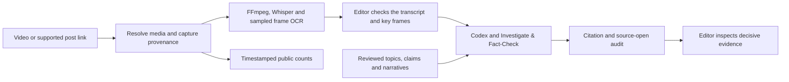

# Agentic investigations

Claim by Claim uses a private Cloudflare Worker for intake and EU D1 for cases, jobs, findings and reviewed relationships. The Mac runs local media tools and Codex while it is awake. An operator can also run the worker on a Linux CPU host.



## Submit and review a video

```sh
bun run db submit "Case title" "https://mastodon.social/@publisher/STATUS_ID"
bun run db submit "Case title" "https://publisher.example/clip.mp4" "https://publisher.example/posts/123"
bun run db submit "Case title" "/absolute/path/to/authorized-copy.mp4" "https://www.youtube.com/watch?v=VIDEO_ID"
bun run db media CASE_ID
bun run db transcript CASE_ID .case-data/transcript-review.json
# Review the original video and edit the transcript before approving.
bun run db approve CASE_ID .case-data/transcript-review.json
bun run db draft CASE_ID
```

Direct HTTPS MP4, MOV and M4V downloads are capped at 100 MiB and ten minutes. For mastodon.social the adapter resolves one public, locally hosted video attachment through the instance API. For YouTube, TikTok, Instagram and other post pages, submit an authorized copy or a supported direct media URL and attach the original post separately. An operator can attach a post to an existing case with `bun run db attach-post CASE_ID POST_URL`. Different posts can carry identical media and distinct engagement observations. [Mastodon public status API](https://docs.joinmastodon.org/methods/statuses/#get) · [YouTube API developer policies](https://developers.google.com/youtube/terms/developer-policies)

The runner records media SHA-256 and source capture metadata. It samples up to eight frames and records the JPEG hashes and presentation timestamps. When OCR is enabled, the timecoded text goes into the review record and can inform Codex searches after transcript approval. Check the displayed text against the original. Use `db observe` to record a human observation and distinguish what appears on screen from an assertion made by a person or document. Raw JPEGs and direct-download scratch files are temporary. Preserve important originals and decisive frames in private storage for cases that need a reproducible evidence package.

## Model routing and final review

| Stage | Tool and limits | Result |
| --- | --- | --- |
| Media and speech | FFmpeg plus local MLX Whisper on Mac or faster-whisper on Linux | A timed provisional transcript with media hash |
| On-screen text | Bounded FFmpeg sampling and optional local Tesseract | Frame timestamps, hashes and OCR leads |
| Related cases | D1 and local cosine scoring on versioned lexical vectors | Up to four reviewed graph records as leads for Codex |
| Investigation | Codex with the Investigate & Fact-Check skill, default ChatGPT authentication and one run per approved transcript | Private claim-level draft with quote, locator, sources, strongest contrary evidence or limits and the next check |
| Verification | Deterministic quote/time validation and source-open audit, followed by a human editor | Flags for absent locators, missing exact URL opens and possible shared origins |

The default runner handles one active job, up to eight claims per research pass and up to 20 starts per UTC month. The audit checks tool telemetry. An editor still inspects the actual passages, confirms relevance and origin, documents any single controlling primary record, checks important visual and translation details, and makes the final publication decision. A missing open event may reflect incomplete telemetry or a URL difference. It remains a review flag. [Investigate & Fact-Check skill](https://github.com/KhademOHAli1/investigate-and-fact-check) · [Codex event format](https://github.com/openai/codex/blob/main/codex-rs/exec/src/exec_events.rs)

## Engagement

Each observation records the post, time, method and source. Mastodon counts mean favourites, replies and boosts as reported by that instance. Views remain unavailable. YouTube's optional API query returns views, likes and comments when exposed. Use `CLAIM_BY_CLAIM_YOUTUBE_API_KEY` with `bun run db youtube-metrics POST_URL` for a one-off lookup. The workflow keeps YouTube API responses outside its historical D1 register. [Mastodon status fields](https://docs.joinmastodon.org/entities/Status/) · [YouTube video statistics](https://developers.google.com/youtube/v3/docs/videos)

Record a direct manual observation with `bun run db engagement CASE_ID observation.json`. Supply a public source and record unavailable counts as `null`. Keep a description if the platform rounds counts or changes a metric definition.

```json
{
  "method": "manual",
  "postUrl": "https://publisher.example/posts/123",
  "sourceUrl": "https://publisher.example/posts/123",
  "observedAt": "2026-11-13T12:00:00Z",
  "counts": { "views": null, "likes": 10, "comments": 0, "shares": null },
  "limitations": ["Public post counters observed at the stated time."]
}
```

Keep metric comparisons within the same provider and definition. A snapshot describes visible engagement at one time. Historical comparisons require comparable observations.

## Topics and narratives

A topic is an editorial question with an entity, jurisdiction or time period where relevant, plus explicit inclusions and exclusions. A claim is one checkable proposition. An occurrence records who made it and where. A narrative is a recurring framing defined in editorial terms. Review each relationship and record the underlying reference before adding it to the graph.

Use `bun run db knowledge-put node.json`, `bun run db knowledge-link edge.json`, `bun run db knowledge-find "query"` and `bun run db knowledge-node NODE_ID`. Nodes use `id`, `nodeType`, `label`, `scope` and optional `provenance`. Use `claimRef: {caseId, claimId}` to point to a case claim. Set `metadata: {researchLead: true}` only when the node's label and scope are cleared to send to Codex as leads for other cases. Links take `fromNodeId`, `toNodeId`, `relation`, `note` and `provenance`. Set `CLAIM_BY_CLAIM_REVIEWER` to record the reviewer. Lexical cosine scores reflect shared words and word pairs, and can miss paraphrases and translations.

## Next increments

1. **Evidence capture and separate review.** Save selected original bytes and pinpointed snapshots to private storage with capture time, origin, method, hash, locator and retention decision. Add a separately budgeted Codex challenge of high-stakes claims using these artifacts. Score how often it catches missing counterevidence, shared sources, quotation errors and overconfident verdicts on reviewed examples.
2. **Semantic retrieval and narrative review.** Benchmark multilingual embeddings on known paraphrases, translations, near misses and contradictory statements about the same event. Keep canonical topics, occurrences and reviewed edges in D1. Introduce a vector index only when the benchmark and measured workload justify it. [Cloudflare Vectorize pricing](https://developers.cloudflare.com/vectorize/platform/pricing/) · [pgvector](https://github.com/pgvector/pgvector)
3. **Discovery and social connectors.** Pilot a bounded watchlist with Media Cloud, RSS or Bluesky. Store discoveries as candidates with provenance and require intake approval before model work. Add further platform connectors once access, media rights and retention rules are established. [Repository and API review](research-tool-review.md)
